# HORIZON HUD

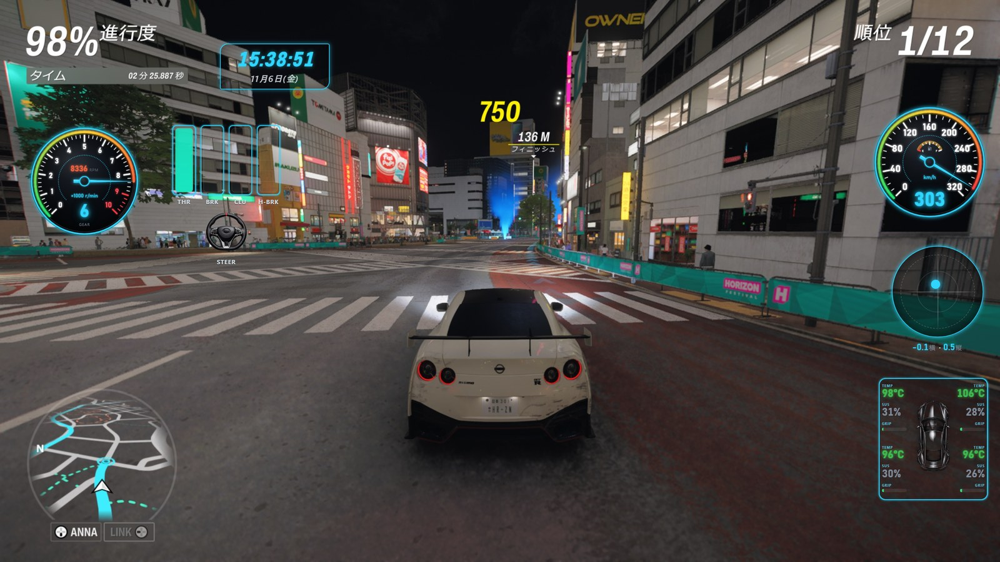

Forza Horizon 6 の公式テレメトリ（Data Out）を受け取って、速度・回転数・ギア・ブースト・G・タイヤ温度などを表示するダッシュボードアプリです。ゲーム画面の上に重ねても、別モニターやスマホに出してもかまいません。カードの配置、見た目、色はすべて自分で決められます。

**[最新版をダウンロード（Releases）](../../releases/latest)**　｜　[English](#english)

---

## ゲーム画面にそのまま重ねられる

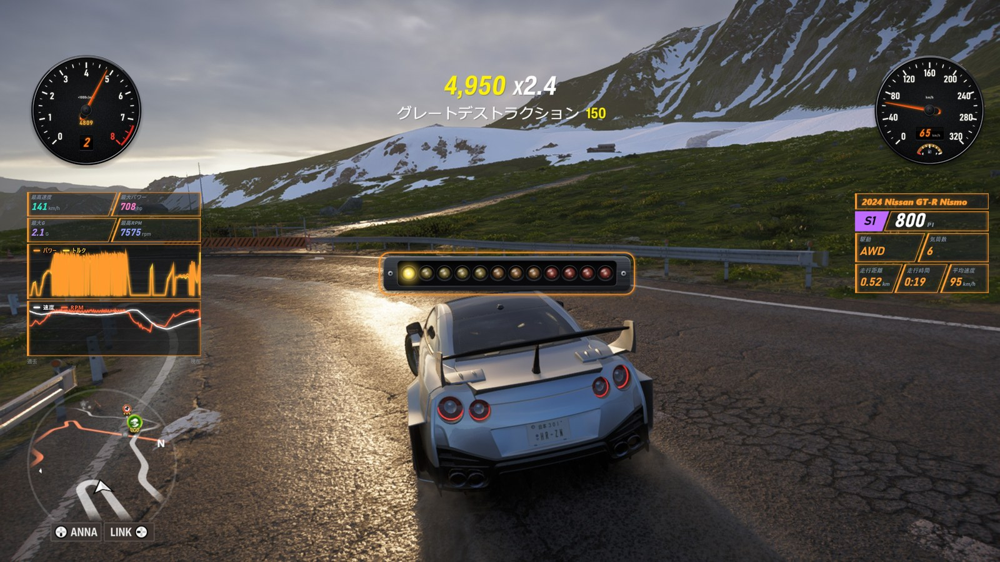

F9 を押すと、HUD だけがゲーム画面の上に透けて表示されます。カードを好きな場所に並べたら F10 でロック。マウスはゲームにそのまま通るので、HUD を出したまま普段どおりに走れます。

- フルHDで作った配置は、WQHD や 4K のモニターでも同じ見た目で表示されます
- 次回から最初からオーバーレイ＋ロックの状態で起動することもできます
- ドリフト用・レース用など、配置を最大 6 つまで保存してキー 1 つで切り替えられます

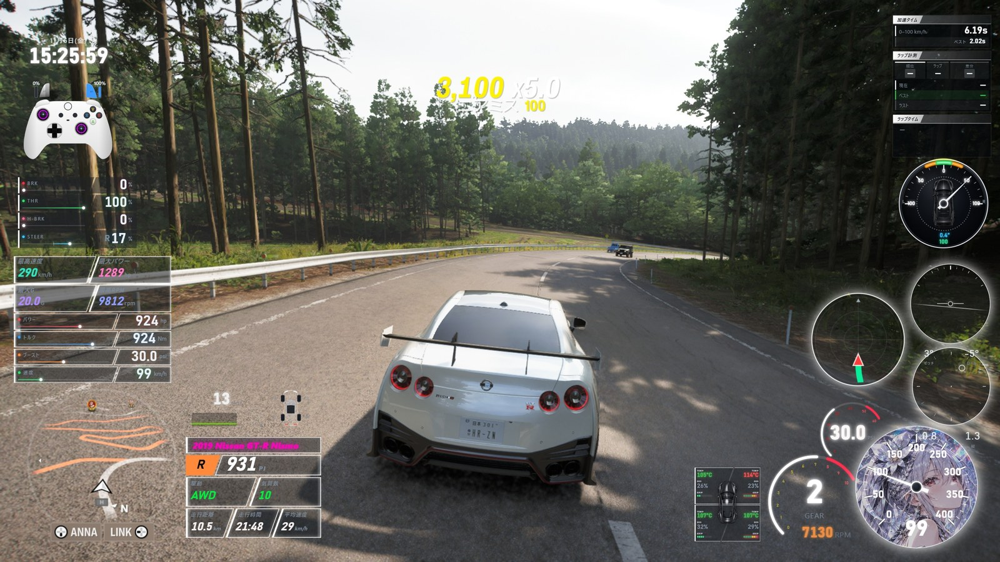

実際にこの配置で走っているときの画面です。カードの数や置き場所は自由に決められます。

## 見た目は自分好みに

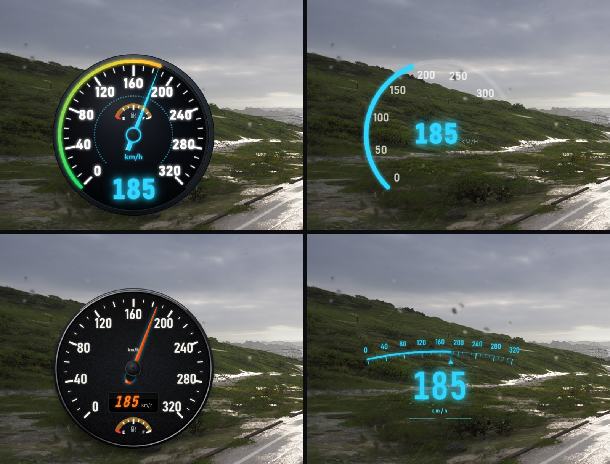

丸メーターは「スタンダード」「シンプル」「クラシック」「アーチ」の 4 スタイル。G-FORCE や RACE ボードにもそれぞれ 4 スタイルがあり、INPUT や LIVE POWER のゲージは 8 種類から項目ごとに選べます。

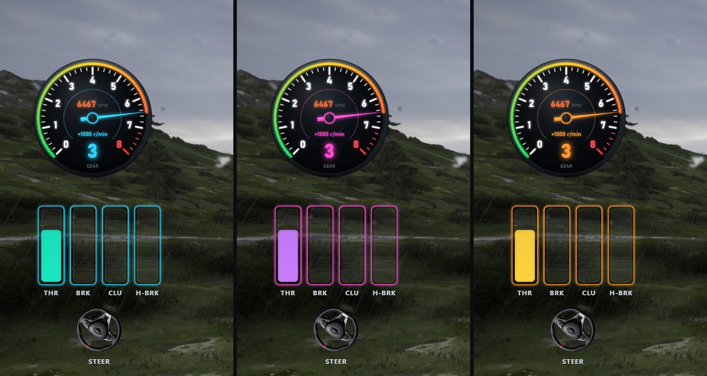

メインカラーを 1 つ選ぶだけで全カードの色がそろいます。カードごとに発光色、ネオン枠、透過率、数字の色まで細かく変えることもできます。夜のレースならシアン、夕方の山道ならアンバー、配信ならマゼンタ、といった使い分けも簡単です。

## 走っていないときは自動で隠れる

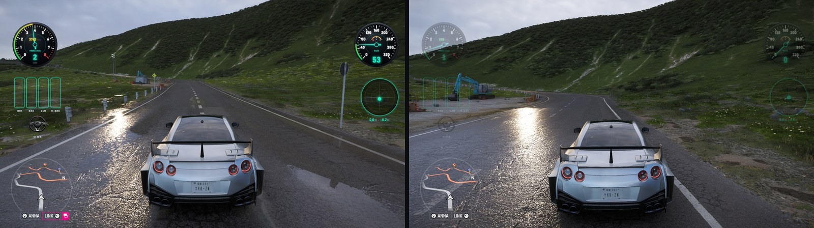

「停車中」「メニュー・ガレージ・ポーズ画面」「ゲームが裏にあるとき」の 3 つの場面ごとに、HUD を表示・薄く表示・非表示から選べます。写真撮影やメニュー操作のときは HUD が消え、走り出せばすぐに戻ります。

## メーターに好きな画像を使える

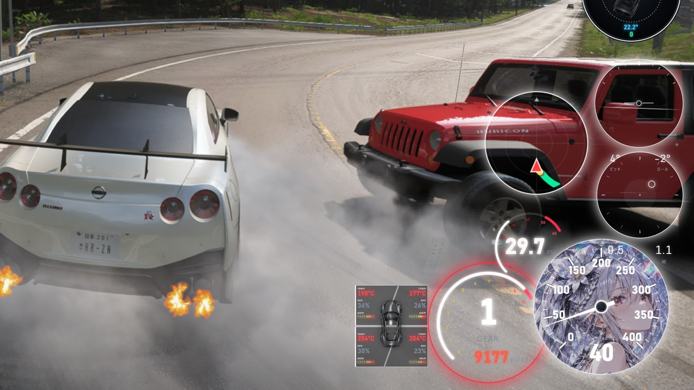

スピード・タコ・ブーストの盤面に、手持ちの画像を丸く切り抜いて設定できます。好きなイラスト、愛車の写真、チームのロゴなど、自分だけのメーターで走れます。ハンドルのアイコンも好きな PNG に差し替えられます。

## カードの例

| | |
| --- | --- |
| 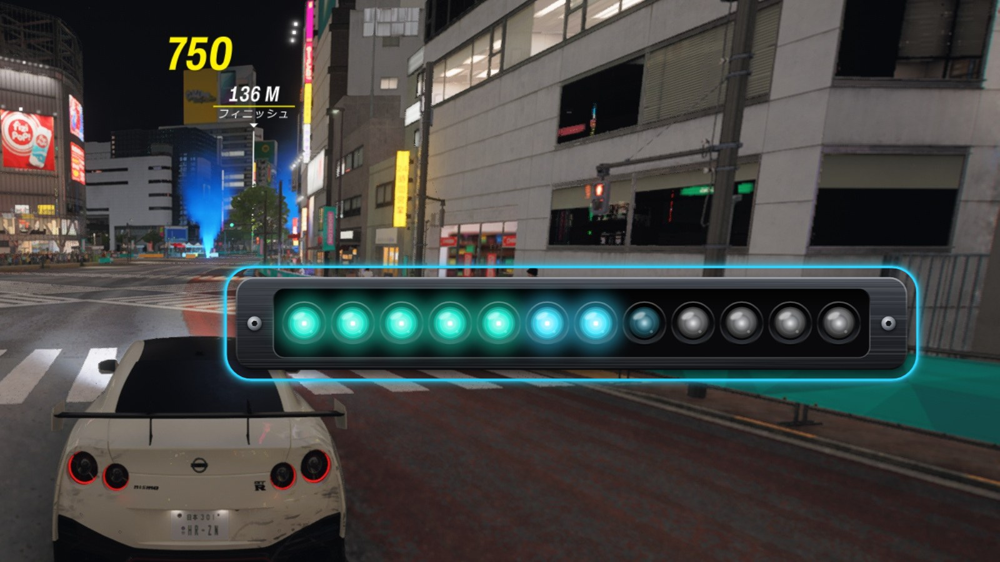 | **SHIFT LIGHT** 独立したカードとして好きな場所に置けるシフトライト。見た目は 6 種類で縦向きにもでき、LED の数や色、点灯タイミングを調整できます。シフト点でビープ音も鳴らせます。 |
| 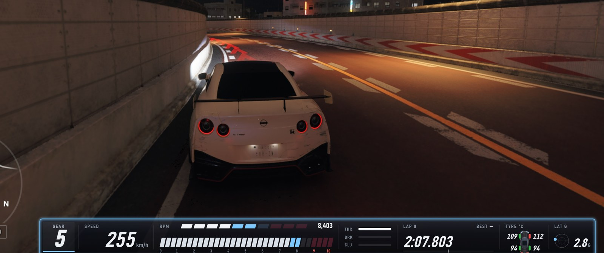 | **ストリップ表示** ギア・速度・回転数・ペダル・ラップ差・タイヤ温度・横 G を 1 本の帯にまとめた表示。画面の端に細く置けるので、走りの邪魔になりません。 |
| 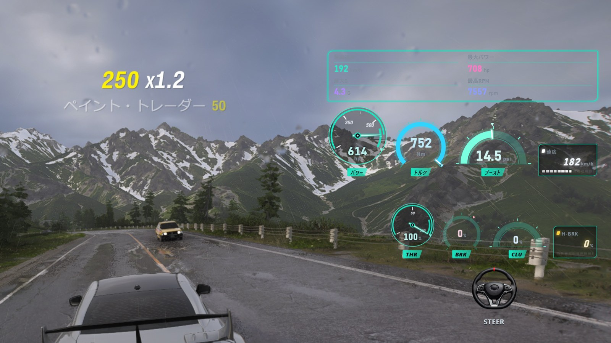 | **LIVE POWER / INPUT** パワー・トルク・ブーストやペダル入力を、グラフか 8 種類のゲージで表示。ペダルの並び順も自由です。 |
| 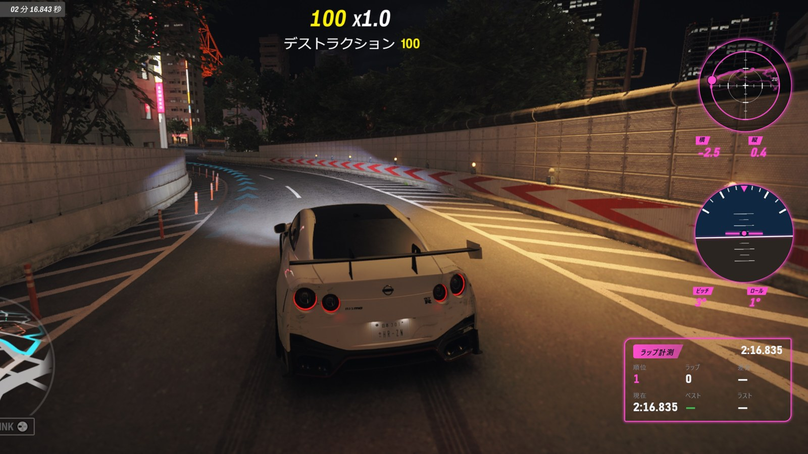 | **G-FORCE / 姿勢 / RACE ボード** G の動きを残像付きで表示。RACE ボードは 0-100 などの加速タイム、ラップ、ベストラップとの差をリアルタイムで表示します。 |
| 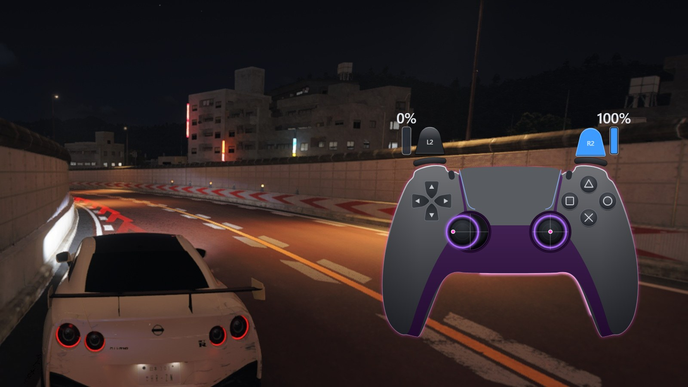 | **ゲームパッド** 手元のコントローラー操作をそのまま表示。トリガーの押し込み量やスティックの位置まで見えるので、配信の手元表示にぴったりです。 |
| 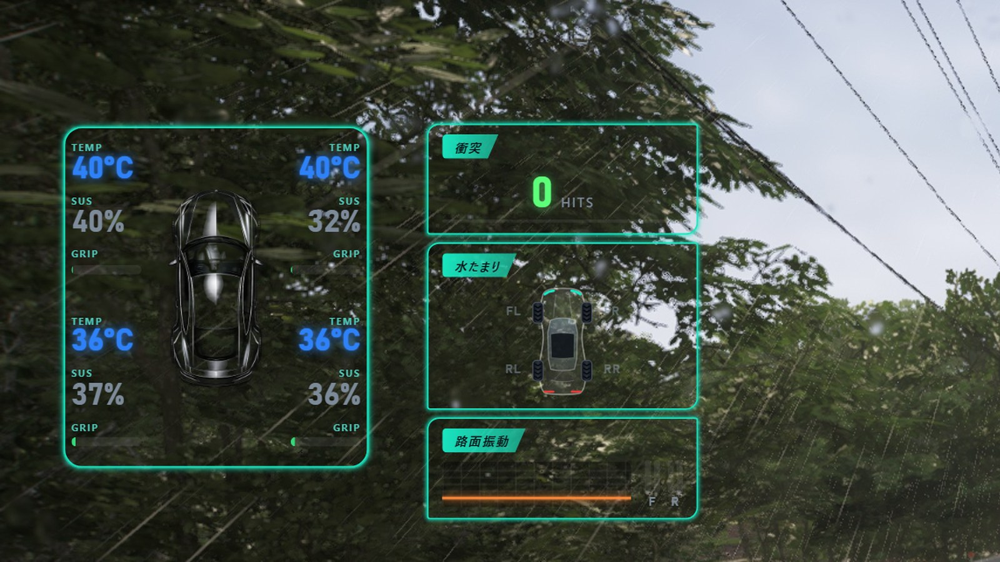 | **TIRES / SURFACE** タイヤ温度・グリップ・サスペンションを俯瞰図で表示。路面カードでは衝突回数、水たまり、路面の振動がわかります。 |

ほかにも、ドリフトコーチ、走行軌跡レーダー、車両情報（車名・クラス・PI）、時計のカードがあります。

## スマホ・別モニターにも

同じ Wi-Fi につながっていれば、アプリに表示される QR コードを読み取るだけでスマホやタブレットに HUD を出せます。スマホに出すカードと配置は PC とは別に決められます。

---

## 使い始めるまで

**動作環境**：Windows 11（64bit）／Forza Horizon 6

1. [Releases](../../releases/latest) から zip をダウンロードして展開し、`HORIZON-HUD-Setup-x.x.x.exe` を実行します。
   - 「Windows によって PC が保護されました」と表示されたら「詳細情報」→「実行」で進めてください（署名なしのインストーラのためです）。
2. ゲームの「設定」→「画面表示とゲームプレイ」の下のほうにある「テレメトリ」を次のようにします。
   - データ出力：オン
   - データ出力 IP アドレス：`127.0.0.1`
   - データ出力 IP ポート：`20440`
3. 車に乗るとメーターが動き出します。オーバーレイを使うときは、ゲームを「ボーダーレス」か「ウィンドウ」モードにしてください。

## キー操作

| キー | 動作 |
| --- | --- |
| F9 | オーバーレイの ON / OFF |
| F10 | ロック（マウスがゲームに通り、HUD は表示だけになる） |
| F11 | HUD 全体を一時的に隠す / 出す |
| F8 | 衝突回数のリセット |
| F7（長押し） | ラップタイム一覧 |
| F6 | LIVE POWER の記録リセット |
| F5 | RACE ボードの記録リセット |
| 好きなキー | 保存レイアウトの切り替え |

どのキーも設定で変更できます。表示言語は日本語・英語を含む 8 言語です。

## 安心して使えるように

- ゲームのメモリの読み書き、DLL の注入、ファイルの改変、入力の自動操作は一切しません。受け取るのは、ゲームが Data Out で送ってくる数値だけです。
- ゲームから取り出した画像などの素材は含みません。
- 外部への通信は、起動時に新しいバージョンがあるかを GitHub に確かめる 1 回だけです（個人情報は送りません）。設定でオフにできます。
- HUD は初期状態ではこの PC の中だけで動きます。スマホ表示は自分でオンにしたときだけ同じ Wi-Fi に公開されます。

## ライセンス

個人の非商用利用に限り無料で使えます。改変・再配布・商用利用はできません。詳しくは [LICENSE](LICENSE) をご覧ください。

本アプリは非公式のファンメイドツールで、Microsoft および Playground Games とは関係ありません。"Forza" と "Forza Horizon" は Microsoft の商標です。

---

# HORIZON HUD (English)

A dashboard app for Forza Horizon 6 that reads the game's official telemetry (Data Out) and shows speed, RPM, gear, boost, G-force, tyre temperatures and more. Put it on top of the game, on a second monitor or on your phone. Where each card goes, how it looks and what colour it is are all up to you.

**[Download the latest version (Releases)](../../releases/latest)**

---

## Right on top of your game

Press F9 and the HUD appears over the game with a transparent background. Arrange the cards, press F10 to lock them, and the mouse goes straight through to the game. Drive as usual with the HUD on screen.

- A layout made at 1080p looks the same at 1440p or 4K
- The app can start already in overlay mode and locked
- Save up to 6 layouts (drift, race, and so on) and switch between them with a single key

A real drive with this layout. How many cards you use and where they go is up to you.

## Make it yours

The round dials come in four styles: Standard, Simple, Classic and Arch. G-FORCE and the RACE board have four styles each, and INPUT and LIVE POWER let you pick from eight gauge types for every item.

Pick one main colour and every card follows it. You can also set the glow colour, neon frame, transparency and number colours card by card. Cyan for night races, amber for sunset mountain roads, magenta for streaming: switching takes seconds.

## Hides itself when you're not driving

For three situations, "While stopped", "Menus, garage & pause" and "Game in the background", choose whether the HUD is shown, dimmed or hidden. It gets out of the way for photo mode and menus, and comes back the moment you drive off.

## Your own images on the dials

Set any picture as the face of the speedometer, tachometer or boost gauge; it is cropped to a circle for you. A favourite illustration, a photo of your car, your team logo: drive with dials that are yours alone. The steering wheel icon can be swapped for any PNG as well.

## A few of the cards

| | |
| --- | --- |
|  | **SHIFT LIGHT** Shift lights as their own card, placed anywhere. Six looks, each also vertical, with adjustable LED count, colours and timing, plus an optional beep at the shift point. |
|  | **Strip display** Gear, speed, RPM, pedals, lap delta, tyre temps and lateral G in one slim band along the top or bottom of the screen. |
|  | **LIVE POWER / INPUT** Power, torque, boost and pedal inputs as a graph or as any of eight gauge types. Put the pedals in whatever order you like. |
|  | **G-FORCE / Attitude / RACE board** G-force with an optional trail. The RACE board shows 0-100 times, laps and a live delta to your best lap. |
|  | **Gamepad** Shows your controller inputs as you play, down to trigger travel and exact stick position. Great as a hands cam for streams. |
|  | **TIRES / SURFACE** Tyre temperature, grip and suspension on a top-down car. The SURFACE card shows collisions, puddles and road vibration. |

There are also cards for a drift coach, a driving-line radar, vehicle info (name, class, PI) and a clock.

## Phones and second screens

On the same Wi-Fi, scan the QR code shown in the app and the HUD opens on your phone or tablet. The phone gets its own choice of cards and layout.

---

## Getting started

**Requirements**: Windows 11 (64-bit), Forza Horizon 6

1. Download the zip from [Releases](../../releases/latest), extract it and run `HORIZON-HUD-Setup-x.x.x.exe`.
   - If Windows shows "Windows protected your PC", click "More info" → "Run anyway" (the installer is not code-signed).
2. In the game, open Settings → HUD and Gameplay and scroll down to the Telemetry section:
   - Data Out: On
   - Data Out IP Address: `127.0.0.1`
   - Data Out IP Port: `20440`
3. Get in a car and the gauges come alive. For the overlay, run the game in Borderless or Windowed mode.

## Keys

| Key | Action |
| --- | --- |
| F9 | Overlay on / off |
| F10 | Lock (the mouse goes through to the game; the HUD is display-only) |
| F11 | Hide / show the whole HUD for a moment |
| F8 | Reset the collision counter |
| F7 (hold) | Lap time list |
| F6 | Reset LIVE POWER records |
| F5 | Reset RACE board records |
| Any key you choose | Switch saved layouts |

Every key can be changed in the settings. The app is available in 8 languages, including English and Japanese.

## Peace of mind

- No game memory reading or writing, no DLL injection, no file modification and no input automation. The app only receives the numbers the game itself sends through Data Out.
- No images or other assets taken from the game.
- The only outside connection is a single check with GitHub at startup for a newer version (no personal data is sent). You can turn it off in the settings.
- By default the HUD runs only on this PC. Phone viewing opens it to your Wi-Fi only when you turn it on.

## License

Free for personal, non-commercial use. Modification, redistribution and commercial use are not permitted. See [LICENSE](LICENSE) for details.

This is an unofficial fan-made tool and is not affiliated with Microsoft or Playground Games. "Forza" and "Forza Horizon" are trademarks of Microsoft.
